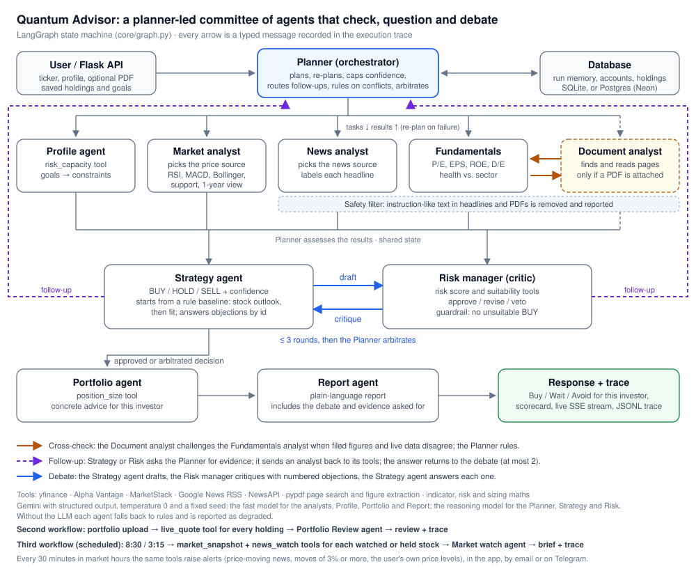

<div align="center">

# 🔮 Quantum Advisor

### A committee of AI agents that plans, argues and explains an investment decision


**Live demo:** https://quantum-advisor.onrender.com

</div>

> [!IMPORTANT]
> Educational decision-support prototype. Not investment advice; consult a SEBI-registered adviser.

## What it does

You enter an NSE ticker and your investor profile (and, optionally, a goal such as *"saving for a house in 3 years"* and the company's annual report or results as a PDF). Ten agents then work on it together, and you watch them on a live committee board:

1. **Planner** decides which analysts this request needs and what each should focus on, using memory of your previous runs.
2. **Market, Fundamentals and News analysts** work in parallel, with the **Document analyst** when a PDF is attached. They choose their own data sources (or, for the document, which pages to read) and switch when one fails.
3. **Planner** checks their results, **re-plans** failed work, and caps the confidence the data can support. If the document's figures disagree with the live data, the Document analyst **challenges** the Fundamentals analyst and the Planner rules which to trust.
4. **Strategy agent** proposes BUY / HOLD / SELL. **Risk manager** approves it, asks for a revision with numbered objections, or vetoes it. They go up to 3 rounds, then the Planner arbitrates.
5. When either of them is unsure, it can **ask for more evidence**: the request goes to the Planner, which sends the right analyst back to its tools (a year of prices, the latest headlines, another page of the report), and the answer goes to the agent that asked.
6. **Portfolio agent** sizes the position from *your* portfolio value; **Report agent** explains the result, including the disagreement.

You can also **upload a portfolio** (or click *Try a sample portfolio*): every holding is priced live and a Portfolio Review agent gives each one an add, hold, trim or review call, with a return-by-holding chart, sector allocation, a risk map and a sparkline per holding.

**Your profile, asked once.** After sign-up a short step asks for your money, any monthly amount you add, your age, experience, when you need the money, how you react to a fall, up to four goals (amount and year), and kinds of company to avoid. The analysis form then shows one summary line ("Change for this analysis" or "Edit profile and goals"). The Profile agent reads the goals; a stock in an avoided category gets a clear note on the decision and in the trace, while the recommendation itself is left to the investor.

**The app.** Signing in lands on **Today**: a greeting, a company search, the latest brief, holdings today, alerts, watchlist movers, recent analyses and your goals. The other sections are **Analyse** (the decision opens at the top with section links; the committee board folds away), **Portfolio** (holdings uploaded once, reviewed live, and the 3:15 closing brief), and **Watchlist** (the 8:30 morning brief, alerts and your own price levels). **History and track record** and **Profile, goals and notifications** sit under your name. On a phone the four sections become a bottom bar.

**Track record.** Every analysis is kept with its price. The History page shows the price one and four weeks later and whether the call was borne out (BUY if it rose, SELL if it fell, HOLD if it stayed within 5%).

**Watchlist and daily briefs.** Search for a company by name as you type, and keep up to 25 on a watchlist. On market days a **Market watch agent** writes a **morning brief at 8:30** (last close, overnight news, what to watch), raises **alerts every 30 minutes** while the market is open (a headline that can move the price, or a move of 3% or more), and writes a **closing brief at 3:15** on your saved holdings (today's profit or loss, the biggest movers, news, stocks near their 52-week high or low, unusual volume, concentration, and what to check before the close). Briefs appear in the app and, if SMTP is configured, by email.

The decision page opens with a **scorecard** (momentum, valuation, profitability, financial health and news on a 0-10 scale, an entry-point verdict and red flags), then an interactive price chart (ranges, moving averages, Bollinger bands, volume, crosshair), signal tiles (including MACD, Bollinger bands, support and resistance), a breakdown of where every risk point comes from, company-health grades, the news split, and how the call compares with your last analysis of the same stock.

All maths and data fetching are done by tools, so the LLM decides and explains but never invents numbers. If the LLM is unavailable, each agent falls back to its rule-based path and the result is marked *degraded*; nothing crashes.

Headlines and uploaded PDFs are treated as data, never as instructions: lines written to steer an AI ("ignore your instructions…") are removed and reported in the trace, and everything else from outside reaches the model marked as untrusted.

## Why several agents instead of one

A single prompt that sees everything tends to commit to its first answer. Here the analysts are independent (so they run in parallel and can fail independently), a filed report is checked against live data by a separate agent, and the Strategy agent's answer must survive a critic whose only job is to protect this particular investor. The Planner adapts the plan when data is missing. The trace shows all of it.

## Architecture



Pattern: **orchestrator–worker with a peer cross-check and a critic loop**, built as a LangGraph state machine (`core/graph.py`). Details, interaction rules and design choices: [`docs/design-document.md`](docs/design-document.md).

| Agent | Decides | Tools |
|---|---|---|
| Planner | plan, re-plan, confidence cap, conflict ruling, routing follow-ups, arbitration | run memory |
| Profile | constraints from profile + goal | `risk_capacity` |
| Market analyst | which price source; reading of indicators | `get_price_history`, `compute_indicators` (trend, RSI, MACD, Bollinger, support/resistance), `volume_signal`, `get_long_history` |
| Fundamentals analyst | health vs. sector; reply to a challenge | `get_fundamentals`, `score_fundamentals` |
| News analyst | which news source; sentiment + materiality per headline | `get_headlines` |
| Document analyst | which pages to read; reported figures and red flags; challenges live data | `find_pages`, `read_page`, `extract_figures`, `compare_with_live` |
| Risk manager | approve / revise / veto with objections; asks for evidence | `market_risk_score`, `suitability_gap` |
| Strategy | BUY / HOLD / SELL; answers to objections; asks for evidence | `price_targets` |
| Portfolio | concrete actions | `position_size` |
| Report | final explanation | — |
| Portfolio Review | a call for every uploaded holding | `live_quote` |

## Free to run

| Service | Free tier used | Needed? |
|---|---|---|
| Google Gemini API (AI Studio key) | free tier; the app rate-limits itself (`GEMINI_RPM`) | Recommended (without it agents use rules) |
| yfinance | no key | Default price + fundamentals source |
| Google News RSS | no key | Default news source |
| Alpha Vantage | 25 requests / day | Optional fallback |
| MarketStack | 100 requests / month | Optional fallback |
| NewsAPI | 100 requests / day (developer plan) | Optional |
| Render | free web service (sleeps when idle) | Hosting |
| Neon or Supabase Postgres | free database (0.5 GB) | Optional: keeps accounts and history across redeploys |
| Google Identity Services | free | Optional: *Continue with Google* |
| GitHub Actions | free for public repos | CI |

Prices and news are cached for 15 minutes to stay within these limits.

## Quick start (Windows PowerShell)

```powershell
git clone https://github.com/sourav-singh-10/quantum-advisor.git
cd quantum-advisor
python -m venv venv
.\venv\Scripts\Activate.ps1
pip install -r requirements-dev.txt

copy .env.example .env      # then fill in the keys you have
$env:GEMINI_API_KEY = "your_key"
$env:REQUIRE_LOGIN  = "0"   # skip login while developing

python app.py               # open http://localhost:5000/
```

Check your configuration with `http://localhost:5000/api/health?deep=1`; it makes one tiny Gemini call and reports whether the model answers.

## Tests

```powershell
pytest -q
```

220+ tests, no network or keys needed (a scripted fake LLM and stubbed data sources). They cover every agentic path: revision changes the decision, deadlock leads to arbitration, the market agent switches source after a failure, the planner re-plans a failed analyst, graceful failure without price data, the guardrail overriding an unsafe approval, memory on a second run, live portfolio pricing with no invented prices, reading a company PDF, dropping a figure the LLM invented, the document-vs-live-data challenge and a document about the wrong company, and real NSE prices recorded on 16 Oct 2026; plus tools, the LLM client, API validation, streaming, password hashing, the documented JSON Schemas against real output, agents asking each other for evidence, ignoring planted instructions in headlines and PDFs, the scorecard, Google sign-in, and the database layer on SQLite and Postgres. CI runs them on every push and pull request, once on SQLite and once on a Postgres service.

To run the suite on your own Postgres: `$env:QA_TEST_DATABASE_URL = "postgresql://..."` (it empties that database first, so use a throwaway one).

## Evaluation

With the app running, `python scripts/evaluate.py --url http://127.0.0.1:5000` analyses five stocks for three investor profiles, twice, and writes `docs/evaluation.md` (and the raw `docs/evaluation.json`): how many agent decisions the model made versus the rules, whether the same input gives the same call, whether different investors get different advice, how often the debate changed the first call, follow-ups, re-plans, guardrails and time per run. `--stocks`, `--repeats` and `--out` change the set; `--redo docs/evaluation.json` re-runs only analyses that Gemini's quota cut off.

`python scripts/evaluate.py --scenarios` checks five situations ordinary runs rarely meet (a price source going down, an analyst failing, a PDF with a planted instruction, a volatile stock for a retiree, a renamed symbol) and writes `docs/scenarios.md`. Start the server with `$env:EVAL_FAULTS = "1"` for the two simulated failures; never set it on the public deployment.

## API

| Method | Path | Purpose |
|---|---|---|
| POST | `/api/analyze` | Run the agents, return JSON (schema: `schemas/analyze_response.schema.json`). JSON body, or a multipart form with the same fields plus an optional `document` PDF (max 15 MB) |
| POST | `/api/analyze/stream` | Same, as Server-Sent Events: `start`, one `trace` per agent message, `result` |
| GET | `/api/runs/<run_id>/trace` | The saved execution trace of a run |
| GET | `/` | Public home page: how the committee works, sign-in and sign-up |
| GET | `/app` | The app: analyse a stock, review a portfolio, past analyses, account |
| GET / PUT | `/api/profile` | Your saved investor profile (pre-fills every analysis) |
| POST | `/api/account/password` | Change your password |
| GET | `/api/auth/config` | Whether Google sign-in is on (`googleClientId`) |
| POST | `/auth/google` | Sign in or sign up with a Google ID token, verified on the server |
| GET | `/api/history` | Your previous runs (memory) |
| GET | `/trace.html?run=<run_id>` | Human-readable trace viewer for any run |
| POST | `/upload_portfolio` | Price a CSV/XLSX of holdings live and review it with the Portfolio Review agent |
| GET | `/api/symbols?q=` | Company suggestions as you type (bundled NSE list, then a live lookup) |
| GET / POST / DELETE | `/api/watchlist` | Your watchlist (`DELETE /api/watchlist/<ticker>` removes one) |
| GET / POST / DELETE | `/api/holdings` | Holdings saved for the 3:15 brief (POST a CSV/XLSX) |
| GET | `/api/briefs` | Latest morning and closing briefs and alerts; writes any brief the server slept through |
| POST | `/api/briefs/<morning\|closing>/refresh` | Write a brief now |
| POST | `/api/cron/tick` | Run whatever is due (needs the `X-Cron-Key` header); called by the GitHub Actions schedule |
| GET | `/api/today`, `/api/today/live` | The Today screen: briefs, alerts, goals and recent analyses; then live holdings and watchlist prices |
| POST | `/api/holdings/review` | Review the saved holdings again without re-uploading (`/upload_portfolio` with `save=1` keeps them) |
| GET / POST / DELETE | `/api/price-alerts` | Your own price levels ("tell me when INFY falls below ₹1,400"), checked in the 30-minute sweep |
| GET / POST / DELETE | `/api/telegram`, `/api/telegram/link` | Connect a Telegram chat for briefs and alerts |
| GET | `/api/track-record` | Each past call with the price one and four weeks later, and whether it was borne out |
| GET | `/api/health` | Status; `?deep=1` also tests the LLM |

Inputs and outputs with samples: [`docs/io-definitions.md`](docs/io-definitions.md).

## Execution traces (CA3 evidence)

Every run writes `logs/traces/<run_id>.jsonl`: one line per message with sender, receiver, type (`plan`, `task`, `tool_call`, `tool_result`, `result`, `error`, `replan`, `assessment`, `challenge`, `reply`, `reconciliation`, `draft`, `critique`, `followup`, `answer`, `arbitration`, `decision`, `memory`, `final`), debate round, payload and the LLM model and latency. To capture submission evidence from the live site, unedited:

```powershell
python scripts/capture_run.py https://quantum-advisor.onrender.com you@example.com yourpassword --name normal --ticker TCS --age 30 --risk Aggressive --horizon Long-term
python scripts/capture_run.py https://quantum-advisor.onrender.com you@example.com yourpassword --name conflict --ticker ADANIENT --age 64 --risk Conservative --horizon Short-term --experience Beginner
python scripts/capture_run.py https://quantum-advisor.onrender.com you@example.com yourpassword --name document --ticker TCS --age 40 --horizon Long-term --document path\to\tcs_results.pdf
```

## Deploy (Render, free)

`render.yaml` defines the service (`gunicorn app:app --workers 1 --threads 8 --timeout 180`). In Render → Environment, set `GEMINI_API_KEY` and any optional data keys; `SECRET_KEY` is generated automatically. Render's free disk is temporary; keep evidence traces in `docs/traces/`.

**Keep data across redeploys (optional, free).** Create a free Postgres database on [Neon](https://neon.tech) or [Supabase](https://supabase.com), copy its connection string, and set it as `DATABASE_URL` on Render (for Neon, keep `?sslmode=require` on the end). The tables are created on first use. Without it the app uses SQLite, and accounts reset when Render redeploys.

**Continue with Google (optional, free).** In Google Cloud Console, create an OAuth client ID of type *Web application*. Under *Authorised JavaScript origins* add `http://localhost:5000` and your Render URL (no redirect URI is needed). Set the client ID as `GOOGLE_CLIENT_ID`. The *Sign in with Google* button opens Google's own window; the server checks that the token was issued to this client ID and that the email is verified. Without `GOOGLE_CLIENT_ID` the button is still shown but explains that Google sign-in is not switched on.

**Briefs on a sleeping server.** A free Render instance sleeps after 15 idle minutes, so the in-app scheduler cannot fire at 8:30 on its own. `.github/workflows/briefs.yml` (free) calls `/api/cron/tick` at 8:35, every 30 minutes in market hours and at 3:20 IST. Add two repository secrets, `APP_URL` and `CRON_SECRET` (copy the value Render generated). Opening the app also writes any brief that was missed. GitHub can start scheduled jobs a few minutes late.

**Keep the demo awake (optional).** `.github/workflows/keepalive.yml` calls `/api/health` every 10 minutes from about 7:30 to 20:30 IST, so the site answers at once during evaluation slots. It uses the same `APP_URL` secret and does nothing until it is set. Turn it off after the evaluation window (Actions → Keep the demo awake → Disable workflow): a free Render service has 750 hours a month.

**Telegram (optional, free).** Create a bot with @BotFather and set `TELEGRAM_BOT_TOKEN` and `TELEGRAM_BOT_NAME`. Each user presses *Connect Telegram* on the Profile page; the bot then sends the briefs and every alert. No webhook is needed: the app reads new messages every minute.

**Email (optional, free).** Set `SMTP_HOST=smtp.gmail.com`, `SMTP_USER`, `SMTP_PASSWORD` (a Gmail app password) and `APP_URL`; each user turns email on in the Watchlist page.

**Full company list.** `data/nse_companies.csv` ships about 280 widely held companies; other names are found with a live lookup. Run `python scripts/update_symbols.py` to replace it with NSE's full list.

## Repository structure

```text
agents/     ten agents plus the portfolio reviewer (LLM decisions + rule fallbacks)
core/       graph.py (LangGraph), runner.py, schemas.py, tracer.py, memory.py, context.py
tools/      data sources and maths the agents call
services/   Gemini client (structured output, retry, rate limit)
schemas/    JSON Schemas for request, responses (stock and portfolio) and trace events
frontend/   home.html (public), login.html, signup.html, terms.html, index.html (the app), trace.html, 404.html,
            css/ (system, agent-flow, player, app pages), js/ (agent-flow, sequence, replay, app, charts), fonts/, samples/
tests/      pytest suite with a fake LLM; fixtures/ holds a sample company PDF
scripts/    capture_run.py (genuine run evidence), evaluate.py (evaluation report), update_symbols.py
docs/       synopsis, design document, I/O definitions, architecture, evaluation, scenarios, traces
```

## Limitations

Data quality depends on free third-party sources; scanned PDFs (no text layer) cannot be read; LLM judgement can be wrong within the guardrails; the risk formulas are simple and not back-tested; this is not investment advice.
