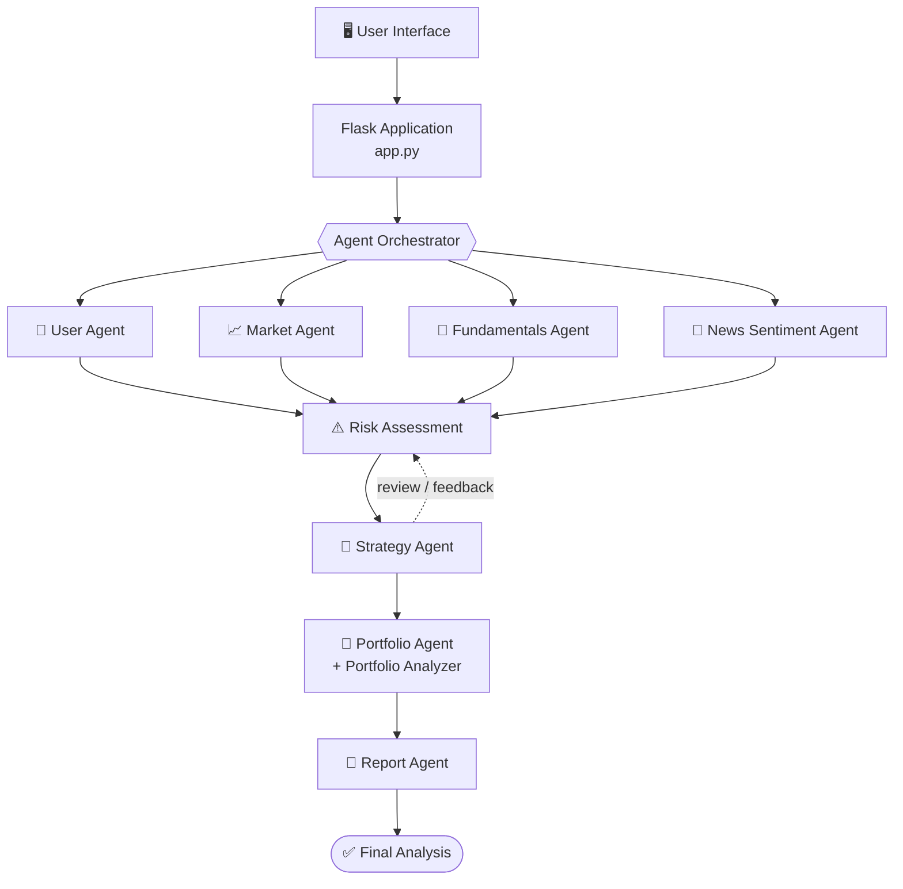

<div align="center">

# 🔮 Quantum Advisor

### Multi-Agent Investment Analysis

*Market, fundamentals, news, risk, strategy and portfolio insights, unified in one workflow.*


[Overview](#-overview) •
[Features](#-key-features) •
[Architecture](#-architecture) •
[Quick Start](#-quick-start) •
[Testing](#-testing) •
[Limitations](#-limitations)

</div>

---

> [!IMPORTANT]
> Quantum Advisor is an **educational decision-support prototype**. It is **not** a substitute for professional financial advice.

## 📖 Overview

Investors often have to evaluate market trends, company fundamentals, news sentiment, personal risk tolerance and portfolio constraints **separately**. Quantum Advisor brings these pieces into **one workflow**, so the results are easier to interpret.

A Flask backend coordinates specialized agents and supporting services, then produces a single consolidated analysis report.

## ✨ Key Features

| | Feature | What it does |
|---|---|---|
| 👤 | **Investor Profiling** | Processes user inputs for personalized analysis |
| 📈 | **Market Analysis** | Evaluates market and price signals from configured data services |
| 🏢 | **Fundamental Analysis** | Produces a structured assessment from available company information |
| 📰 | **News & Sentiment** | Processes news information when the data pipeline is available |
| ⚠️ | **Risk Assessment** | Scores risk using the implemented logic |
| 🎯 | **Strategy Generation** | Builds a recommendation from the available analytical outputs |
| 💼 | **Portfolio Analysis** | Provides portfolio-oriented calculations and insights |
| 📄 | **Report Generation** | Consolidates everything into a user-facing report |

## 🏗️ Architecture

<div align="center">


</div>

<details>
<summary><b>View as Mermaid diagram</b> (text-based, easy to edit)</summary>



</details>

The orchestrator coordinates the workflow and passes structured results between components. The Risk Agent can review the generated strategy and request a revision when the implemented conditions require it.

> [!NOTE]
> This diagram shows the intended workflow. Confirm the exact execution order against the current implementation before submission.

### 🤖 Agent Responsibilities

| Component | Responsibility |
|---|---|
| **Orchestrator** | Coordinates execution and information flow |
| **User Agent** | Processes investor inputs and profile information |
| **Market Agent** | Analyzes available market-related signals |
| **Fundamentals Agent** | Evaluates available company fundamentals |
| **News Sentiment Agent** | Processes configured news and sentiment inputs |
| **Risk Agent** | Assesses risk and reviews the proposed strategy |
| **Strategy Agent** | Generates a recommendation from the available analysis |
| **Portfolio Agent** | Produces portfolio-oriented insights |
| **Portfolio Analyzer** | Performs portfolio calculations |
| **Report Agent** | Consolidates outputs into the final report |

> [!NOTE]
> Separate agents do not by themselves imply autonomous LLM reasoning. The actual degree of autonomy depends on each component's implementation.

## 🧰 Technology Stack

| Layer | Technology |
|---|---|
| Language | Python |
| Backend | Flask |
| Frontend | Project frontend served through the application |
| Data integration | MarketStack and configured price/news services |
| Database | SQLite |
| LLM integration | LLM service layer (when configured) |
| Testing | pytest |
| Version control | Git & GitHub |

## 📁 Repository Structure

```text
Quantum-Advisor/
├── agents/            # Specialized analysis agents
├── services/          # Data and LLM service layers
├── frontend/          # User interface
├── tests/             # pytest suite
├── logs/              # Execution traces
├── app.py             # Flask entry point
├── config.py          # Configuration and env variable names
├── orchestrator.py    # Workflow coordination
├── requirements.txt
└── README.md
```

*Refer to the repository for the complete list of files.*

## 🚀 Quick Start

### Prerequisites

- Python
- Git
- Internet access for any enabled external APIs

### 1. Clone and install

```powershell
git clone https://github.com/Utsav99552/Quantum-Advisor.git
cd Quantum-Advisor

python -m venv venv
.\venv\Scripts\Activate.ps1

python -m pip install -r requirements.txt
```

### 2. Configure API keys

The app reads API keys from environment variables. Use the variable names expected by `config.py`, for example:

```powershell
$env:MARKETSTACK_API_KEY   = "your_key"
$env:ALPHAVANTAGE_API_KEY  = "your_key"
$env:NEWS_API_KEY          = "your_key"
```

> [!WARNING]
> Replace the example values locally. Never commit real credentials to GitHub or share them in screenshots.

### 3. Run

```powershell
python app.py
```

Open the local URL printed by Flask in your browser. The exact URL and port depend on the application configuration.

## 🧪 Testing

```powershell
pytest -q
```

**Latest recorded result:** ✅ 8 tests passed

The suite covers risk assessment, orchestration, and mocked market-agent API interactions.

> [!NOTE]
> Passing mocked tests verifies the tested code paths. It does not prove that external API credentials or live integrations are working.

## 🔍 Execution Trace

An execution trace is stored at `logs/agent_trace.jsonl`. It records events from an analysis run, including agent completion, risk assessment, strategy review and run completion.

- Use a trace from a **real, successful run** as evidence.
- Check logs for sensitive information before including them in a public submission.

## 📦 CA3 Submission Checklist

      Architecture diagram showing data flow and orchestration
      Agent responsibilities and interaction rules
      Input/output JSON schemas with sample payloads
      A genuine execution trace
      Automated test results
      Deployment URL :- https://quantum-advisor.onrender.com/

## ⚠️ Limitations

- Market information depends on the configured data providers and their availability.
- Missing or stale external data may affect analytical outputs.
- Recommendations may use rule-based scoring and should be interpreted according to the implemented logic.
- LLM-generated text, where enabled, may contain errors.
- This prototype is not a substitute for a SEBI-registered investment adviser or independent financial research.

## 🚀 Live Demo

**Live Application:** [Quantum Advisor](https://quantum-advisor.onrender.com)

Try the deployed application to analyze stocks, upload a portfolio CSV, and view risk insights and per-stock recommendations.


---

<div align="center">

*Built for learning. Not financial advice.*

</div>
