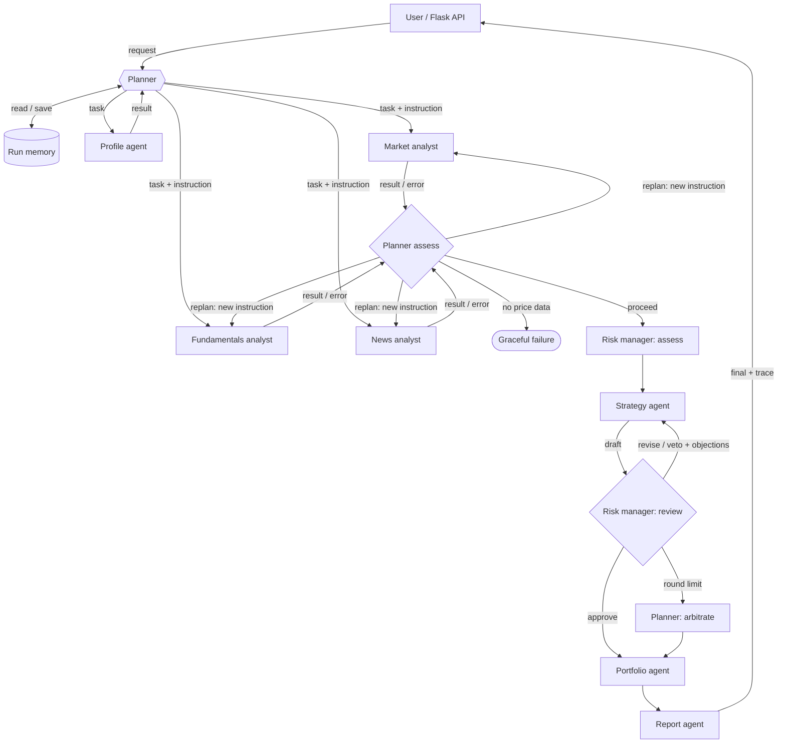

# Quantum Advisor — Design Document

## 1. Architecture

Source of truth: `core/graph.py` (LangGraph state machine). The same graph as text:

Data flows down through one shared state object (`core.graph.State`); every hand-off is also emitted as a typed message to the tracer (`core/tracer.py`), which writes `logs/traces/<run_id>.jsonl` and streams the message to the browser.

## 2. Agents and responsibilities

| Agent | File | What its LLM decides | Tools it calls | Sends to |
|---|---|---|---|---|
| Planner | `agents/planner_agent.py` | Which analysts to run and their instructions; whether results are good enough or which analyst to retry differently; the maximum confidence the data supports; the final call when Strategy and Risk deadlock | Run memory | All agents |
| Profile agent | `agents/profile_agent.py` | Investor summary, max single-stock position %, horizon, constraints implied by the free-text goal | `risk_capacity` | Planner |
| Market analyst | `agents/market_agent.py` | Which price source to call next after seeing earlier failures; interpretation of indicators and data quality | `get_price_history` (MarketStack, Alpha Vantage, yfinance), `compute_indicators` | Planner |
| Fundamentals analyst | `agents/fundamentals_agent.py` | Health label and key points relative to the sector | `get_fundamentals` (yfinance), `score_fundamentals` | Planner |
| News analyst | `agents/news_agent.py` | Which news source to use; sentiment and materiality of each headline | `get_headlines` (NewsAPI, Google News RSS), keyword scorer as fallback | Planner |
| Risk manager | `agents/risk_agent.py` | Key risks for this investor; approve / revise / veto each strategy draft with numbered objections | `market_risk_score`, `suitability_gap` | Strategy, Planner |
| Strategy agent | `agents/strategy_agent.py` | BUY / HOLD / SELL, confidence and rationale; a response to every objection by id | `price_targets` | Risk manager |
| Portfolio agent | `agents/portfolio_agent.py` | Concrete action lines for this investor | `position_size` | Planner |
| Report agent | `agents/report_agent.py` | Plain-language report including the debate and missing data | — | User |

## 3. Orchestration pattern

**Orchestrator–worker with a critic loop**, implemented as a LangGraph `StateGraph`.

- *Orchestrator–worker*: the Planner is itself an LLM agent that decomposes the request and dispatches analysts as workers. The analysts are independent of each other, so they run in parallel (`ThreadPoolExecutor` inside the `analysts` node).
- *Critic loop*: the decision is not left to a single agent. Strategy and Risk have opposing goals (return vs. protection), and a separate critic catches the overconfident first answers that a single agent tends to confirm. The loop is bounded (3 rounds) and ends with Planner arbitration, so it always terminates.

**Why LangGraph:** the routing after `assess` and after `review` is conditional on what the agents decided (`add_conditional_edges`), which a fixed pipeline cannot express; the shared typed state makes every agent's input explicit; and it is a recognised agent framework, so we did not have to build our own scheduler. **Why not a peer-to-peer chat between all agents:** analysts do not need each other's output, and free-form chat would make runs slower, costlier and harder to trace.

## 4. Interaction rules

1. Every message is typed: `request, plan, task, tool_call, tool_result, result, error, replan, assessment, draft, critique, arbitration, decision, memory, final` (`schemas/trace_event.schema.json`).
2. Every LLM decision uses a Pydantic schema (`core/schemas.py`) sent to Gemini as the response schema. Invalid JSON is retried once; then the agent uses its rule-based fallback and is listed in `meta.degradedAgents`.
3. MarketAnalyst is mandatory; if the Planner leaves it out it is added back and the trace says so.
4. A failed tool returns an error observation to the agent, which may choose another tool argument. A failed analyst sends an `error` message to the Planner, which may re-plan once (`MAX_REPLANS`).
5. Strategy must answer each objection by id. Risk keeps ids stable and must not add new objections to prolong the debate.
6. Guardrails override the LLM where a mistake would harm the investor: Risk cannot approve a BUY whose suitability gap exceeds 15 (objection `G1`), a vetoed BUY can never be the final decision, confidence is capped by the Planner's data-quality assessment, and position size never exceeds the Profile agent's limit.
7. Without price data the run stops cleanly with an explanation (HTTP 502) rather than guessing.

## 5. Adaptation, memory and failure handling (where to see it in the trace)

| Behaviour | Trace evidence |
|---|---|
| Planning | `Planner → team plan` with reasoning and per-analyst instructions |
| Tool choice and switching | `MarketAnalyst → tool:get_price_history` calls with the LLM's `thought`, followed by `tool_result ok:false` and a call to a different source |
| Re-planning | `Planner → team assessment action=retry`, then `Planner → <analyst> replan` |
| Critique and revision | alternating `draft` / `critique` messages with `round` 1..3 |
| Arbitration | `Planner → team arbitration` |
| Memory | `memory → Planner memory` on a repeated ticker, and the Planner prompt cites it |
| Degradation | `llm.ok:false` with `fallback:"rules"` on the affected messages |

## 6. Technology choices

| Choice | Why |
|---|---|
| Python 3.12, Flask | Team familiarity; small API surface; Server-Sent Events for the live agent feed |
| LangGraph | Conditional routing, bounded loops and typed shared state (Section 3) |
| Google Gemini via `google-genai` | Native JSON-schema output; free tier is enough for a prototype |
| Model per agent | Analysts, Profile, Portfolio and Report use the fast model (`GEMINI_FAST_MODEL`): narrow tasks where latency matters. Planner, Strategy and Risk use `GEMINI_REASONING_MODEL`: multi-step judgement where quality matters. Both are environment variables. |
| Pydantic | One definition for API validation and LLM output schemas |
| pandas | Indicator maths |
| MarketStack, Alpha Vantage, yfinance | Three price sources so one failing key or quota does not stop the system |
| NewsAPI, Google News RSS | Keyed source plus a key-free fallback |
| SQLite | Users and run memory; no extra service to deploy |
| pytest + GitHub Actions | ~100 tests run on every push and pull request; LLM paths are tested with a scripted fake LLM |
| Render | Free hosting with GitHub auto-deploy (`render.yaml`) |

## 7. Input and output

See `docs/io-definitions.md` and the JSON Schemas in `schemas/`. The response schema is checked against real output by `tests/test_schemas.py`, so documentation and code cannot drift silently.

## 8. Limitations

- Market data depends on third-party keys, quotas and symbol coverage; yfinance is unofficial.
- LLM output can still be wrong within the schema; guardrails cover the harmful cases, not every error.
- The risk formulas are simple and not back-tested.
- Render's free disk is ephemeral: run memory and traces reset on redeploy (evidence traces are committed under `docs/traces/`).
- Educational prototype; not investment advice.
